<div align="center">

<a href="https://secondc.vercel.app"></a>

# SecondChance

**Earlier attention. Shorter waits. More animals home.**

A predictive analytics project built at UNC Charlotte that reads the City of Austin's public shelter records, estimates which animals may wait longest, and turns that into a practical outreach plan — so attention goes to animals earlier, never away from them.

<p align="center"><a href="https://secondc.vercel.app"></a>&nbsp;<a href="LICENSE"></a>&nbsp;<a href="web"></a>&nbsp;<a href="pyproject.toml"></a>&nbsp;<a href="https://data.austintexas.gov/"></a></p>

</div>

<details>
<summary><strong>Skip to a section</strong></summary>

- [What SecondChance does](#what-secondchance-does)
- [The one rule](#the-one-rule)
- [The pages](#the-pages)
- [How the data flows](#how-the-data-flows)
- [The model](#the-model)
- [What the numbers mean](#what-the-numbers-mean)
- [Brand and design system](#brand-and-design-system)
- [Quick start](#quick-start)
- [Repository layout](#repository-layout)
- [Testing](#testing)
- [The research behind it](#the-research-behind-it)
- [Limitations](#limitations)
- [Team](#team)
- [Data, attribution and licence](#data-attribution-and-licence)

</details>

<p align="center"></p>


## What SecondChance does

Every hour the City of Austin publishes intake and outcome records for the Austin Animal Center. SecondChance reads them, pairs each arrival with the outcome that closed it, counts the stays still open, and computes waits, medians and adoption rates from what actually happened. For each open cat or dog stay a model estimates, from what was known at intake, the chance the stay runs past 60 days and the chance of adoption by day 30.

Staff see three things side by side: **what was observed** (the wait, the record), **what was estimated and when** (an intake-time estimate, never a forecast from today), and **what a written rule suggests doing about it**. A planner turns a shortlist into a week of outreach work with every assumption written down.

| For | It offers |
|---|---|
| Shelter staff and volunteers | A triage queue that leads with actual waiting time, a record page per animal, and a plan builder with CSV and print exports |
| Shelter leadership | Twelve-month trends, outcome shares and life-stage waits with definitions attached to every figure |
| Reviewers and other shelters | A fully documented data path, model evaluation, subgroup checks, and a workflow that transfers even though the model does not |


## The one rule

<p align="center"></p>

> **A high predicted long-stay risk is a request for more help, not less.** Scores route help toward animals. They must never be used to justify euthanasia, intake refusal, or reduced care.

That policy ships on every operational page, in the data drawer, on Impact and on How it works. It is enforced in code where it can be: the public records grid receives a projection type with no field that could carry a score, and the intervention rules never prescribe a medical action.


## The pages

<p align="center"></p>

| Path | Page | What it is for |
|---|---|---|
| `/` | **Shelter overview** | Live open-stay count, four headline figures with “What this means”, needs-attention preview, trends, model context, and a three-step workflow guide |
| `/queue` | **Animals that may need extra support** | Open stays with intake-time estimates beside actual waits; URL-backed filters, chips, table or cards, “View record” and “Add to plan” |
| `/discover` | **Explore shelter records** | Public browsing of open records with search, age and wait filters, bounded batches, no scores |
| `/discover/[id]` | **Name · Animal ID** | Stay timeline, recorded facts (age now vs. at intake, unknown ≠ no), staff estimates with horizon, data-quality notes, suggested support, official contact link |
| `/planner` | **Build this week’s outreach plan** | Capacity → available actions → review; manual picks first, automatic fill in rotation; planning estimate in percentage points; local progress checklist; CSV and print |
| `/impact` | **Turning shelter data into earlier support** | Three concrete uses, what the data shows, potential vs. measured, national applicability, the guardrail |
| `/model` | **Understand the data and predictions** | Plain-language intro, data and refresh, metric guide, predictions, testing, subgroup checks, limitations, technical lineage |
| `/about` | **About SecondChance** | Project origin, the team, Austin and beyond, what it can and cannot do |


## How the data flows

<p align="center"></p>

```
City of Austin Socrata API            (hourly publication)
  │  pyqf-r2dc  intakes   ─┐  current ShelterBuddy feeds, from 5 May 2025
  │  gsvs-ypi7  outcomes  ─┘
  ▼
web/src/lib/austin/client.server.ts   paged reads, stable ordering, retries; portal metadata for rowsUpdatedAt
web/src/lib/austin/schemas.ts         zod validation; rejected rows are counted, never dropped
web/src/lib/austin/build-episodes.ts  each intake paired with the outcome that names it; near misses marked ambiguous
web/src/lib/austin/current-inventory.ts open stays as of one snapshot, on Austin's clock
web/src/lib/austin/metrics.ts         medians, cohort rates with eligible denominators, outcome shares, monthly series
web/src/lib/model/registry.server.ts  eligible open stays scored by the committed model artifact
web/src/lib/shelter.server.ts         the finished view, cached for 30 minutes, the only module a page imports
```

Five clocks are kept apart and named in the data drawer: the publisher's last write (`rowsUpdatedAt`), the newest row stamp, the newest animal event, this site's retrieval time, and the snapshot moment. Austin's floating timestamps are America/Chicago wall-clock time; they are converted through that zone before being compared with anything real (`web/src/lib/austin/time.ts`). There is no push subscription: the site re-reads the feeds on a bounded schedule, and a new request never counts as a new publication.


## The model

Two LightGBM classifiers trained on completed stays from the current feeds, calibrated with isotonic regression on a later validation block, and evaluated on a still-later held-out test block. Every metric on the site is read from the committed artifact `web/src/data/model/model.json`; nothing is typed in by hand. Golden vectors written by the trainer are replayed through the TypeScript evaluator in tests so the two cannot drift.

<p align="center"></p>

| Target | Evaluated on | ROC AUC | ECE | Lift in top 50 |
|---|---|---|---|---|
| Stay past 60 days | 3,079 held-out stays | 0.694 | 0.047 | 5.57× |
| Adopted by day 30 | 3,217 held-out stays | 0.803 | 0.062 | 2.39× |

Both estimates are answered **at intake**. For an animal already past 60 days the site leads with that fact and keeps the intake estimate as context. Subgroup performance is reported by species, life stage, intake condition, breed structure and coat colour, in percentage points with group sizes; small groups are shown without a judgement. One known population issue is disclosed on How it works: stays recorded with an intake condition of “Dead” are present in the evaluation set and removing them requires a documented retrain.


## What the numbers mean

A single metric registry (`web/src/lib/metrics/registry.ts`) defines every figure once — meaning, unit, formula, window, sample, use, limitation and source — and feeds the dashboard tiles, chart notes, record pages, the data drawer and the How it works glossary. A few that are easy to misread:

- **Adopted within 30 days** divides by arrivals that have had a full 30 days, not by all arrivals.
- **Median days to adoption** is a statistic over adopted animals only; the adopted sample is shown beside it.
- **Monthly intakes and adoptions** are two event counts that can involve different animals; the lines are never divided.
- **Historical evidence** on the planner means an association in the 2013–2022 archive; nothing on the site is a measured intervention effect.
- **The planning estimate** is an assumed increase in **percentage points**, capped at 100% per animal, with rows past their 30-day window counted as hypothetical.


## Brand and design system

The identity is the logo: the navy of the dog and the teal of the arrow that reopens the circle. Colours resolve through CSS custom properties in `web/src/app/globals.css`; a raw hex in a component is a bug.

<p align="center"></p>

| Role | Light | Dark |
|---|---|---|
|  Navy | `#05274C` | ground, `#041D38` deep |
|  Teal | `#0A9E84` (`#0A7A66` for text) | `#2FC3A5` (`#4FD8BC` strong) |
|  Page / card | `#F6F8F8` / `#FCFDFD` | `#06111B` / `#0C1B27` |
|  Ink | `#0A1620` | `#F2F7F7` |
|  Warm accent | `#D9642F`, rationed for long waits and calls to act | `#F0864F` |

Typography is **Manrope** for prose and interface and **IBM Plex Mono** for IDs and timestamps, with tabular numerals wherever values align. Motion is one system: Lenis smooth wheel scrolling driven from the GSAP ticker, masked line reveals for main headings, a 420ms section entrance, animated section dividers, a 220ms route transition, and a circular-reveal mobile menu — all immediate under reduced motion. Third-party motion sources are recorded in [`web/ATTRIBUTION.md`](web/ATTRIBUTION.md).


## Quick start

### The web app

```bash
cd web
npm install
npm run dev            # http://localhost:3000, reads Austin's feeds anonymously
```

Everything in `web/.env.example` is optional. A Socrata app token gives the site its own throttling pool; set it before taking real traffic.

```bash
npm run typecheck && npm run lint && npm test && npm run build
```

### The research pipeline

```bash
make setup      # install the package and dev dependencies
make data       # download the raw archive CSVs, about 40 MB, once
make all        # reproduce every number, figure, PDF and the demo site
```

About 35 minutes on two cores, random seed 20260820 throughout. `make help` lists every target; the pipeline is ten plain scripts that can be rerun individually (`make episodes`, `make features`, `make train`, …). `analysis/20_train_shelterbuddy.py` trains and exports the model the web app actually serves.


## Repository layout

```
web/                     the Next.js 15 application (App Router, React 19, TypeScript strict, Tailwind v4)
  src/app/                 routes: /, /queue, /discover, /discover/[id], /planner, /impact, /model, /about
  src/components/          shell, motion primitives, dashboard, queue, discover, planner, model, ui
  src/lib/austin/          Socrata client, schemas, episode pairing, inventory, metrics, time, status
  src/lib/model/           artifact types, feature derivation, tree evaluator, horizon labels, presentation
  src/lib/metrics/         the shared metric registry
  src/lib/planner.ts       plan building, scenario arithmetic, CSV export
  src/data/model/          the committed model artifact
  tests/                   vitest: episodes, model parity, time/status, metrics, planner/CSV
src/secondchance/        the Python library behind the archive study and the trainer
analysis/                the numbered research scripts, plus 20_train_shelterbuddy.py
tests/                   366 Python tests
docs/                    model card, runbook, cost model, data dictionary, decision log, upgrade checklist
deliverables/            paper, literature review, reviews, outline, work plan (built to PDF)
results/                 MEASURED_RESULTS.json, figures, tables
sql/  infra/  scripts/   warehouse SQL, the SAM template, verification scripts
```


## Testing

<p align="center"></p>

```bash
cd web && npm test          # 58 unit tests: episodes, model parity, Austin time and freshness,
                            # cohort metrics, horizon labels, planner maths, CSV safety
make check                  # Python: lint, type check, 366 tests, 94% coverage
```

The tests that matter most are the ones guarding silent errors: a wrong intake–outcome pairing, a floating timestamp compared to UTC, a rate divided by the wrong denominator, or a CSV cell that opens as a formula.


## The research behind it

The project began as a study of the full Austin archive (October 2013 to March 2022, 136,898 episodes) under the previous shelter system. Those findings still stand and are kept in `deliverables/` and `docs/`; the archive model is **not** the one scoring the site, because the source system, schema and animal-ID namespace all changed in May 2025.

<p align="center"></p>

1. **The standard estimator is wrong here, by a lot.** Fifty-one percent of exits are not adoptions. Treating transfers as ordinary censoring overstates 30-day adoption by 23.7 percentage points; by one year the naive estimator says 98.8 percent of arrivals are adopted, the correct figure is 48.3.
2. **Calibration failed before discrimination.** Frozen on 2018 data and run into March 2020, the model's ranking barely moved (AUC 0.778 → 0.789) while its probabilities drifted up to 7.6 points. A dashboard watching AUC alone would have called it healthy.
3. **The language model earns its place on one target and not the other.** A structured breed reference beats a keyword baseline by 0.012 AUC on long-stay risk and by 0.0003 on 30-day adoption.
4. **Three classes of feature silently break a drift detector** — monotone calendar time, near-constant shelter-level covariates, and calendar cycles — and are handled explicitly.

Archive results (train through 2018, calibrate 2019, test 2020 – Jan 2022):

| Target | Base rate | AUC | ECE | lift@50 |
|---|---|---|---|---|
| Adopted within 7 days | 16.6% | 0.827 | 0.022 | 4.33 |
| Adopted within 30 days | 37.2% | 0.803 | 0.023 | 2.52 |
| Long stay past 60 days | 11.6% | 0.765 | 0.018 | 4.15 |

`results/MEASURED_RESULTS.json` is the single source of truth for those figures; `scripts/verify_numbers.py` asserts that every document reproduces them.


## Limitations

- **No behavioural data.** The strongest remaining signal is not in any public export.
- **Breed is a staff guess.** Findings about bully-type labels are findings about a label, not about animals.
- **The queue finds animals; nobody has shown that acting on it changes what happens to them.** That needs a prospective study. The site says “potential benefit”, never “animals saved”.
- **One shelter, one city.** The workflow transfers; the model should be retrained and re-evaluated locally before use anywhere else.
- **Dead-on-arrival records** are present in the current model's evaluation set; see How it works.


## Team

**Built by Davis Higgins, Bennett Shearin, Seth Sumter, and Hunter Pace** — UNC Charlotte project team, DTSC 3601.

SecondChance is a student research prototype. It is not affiliated with the Austin Animal Center, and an open intake record on the site does not confirm that an animal is available for adoption.


## Data, attribution and licence

- Austin Animal Center Intakes and Outcomes, current feeds `pyqf-r2dc` and `gsvs-ypi7` (hourly, from 5 May 2025), and archives `wter-evkm` and `9t4d-g238` (frozen at the cutover) — City of Austin Open Data Portal, public domain.
- Motion components adapted from a privately licensed pack are documented, with original paths and every change, in [`web/ATTRIBUTION.md`](web/ATTRIBUTION.md). They are not redistributed.
- Manrope and IBM Plex Mono, SIL Open Font License 1.1.

The source code in this repository is released under the [MIT License](LICENSE).

<p align="center"></p>

<p align="center"><a href="https://secondc.vercel.app"></a></p>

<p align="center">
  <a href="https://secondc.vercel.app"></a>&nbsp;
  <a href="https://github.com/DavisHiggins"></a>
</p>
